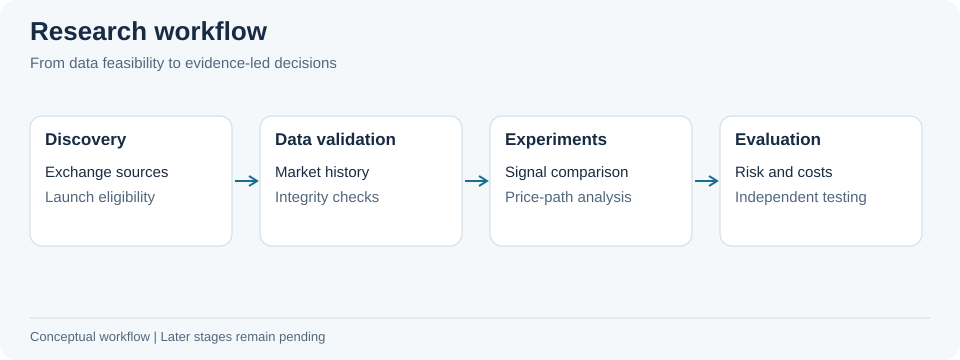
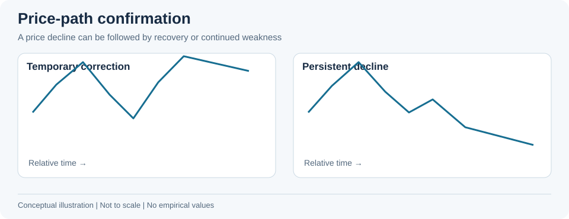

# New Token Market Behavior Research

**Quantitative research · Market data engineering · Systematic trading research**

> Research in progress — initial data feasibility established; no validated trading strategy.

## Abstract
This study investigates price behavior following initial cryptocurrency listings. The central question is whether completed price observations can distinguish temporary corrections from persistent downside movement, subject to realistic execution and risk constraints. The public repository documents the research process and selected evidence without disclosing the proprietary implementation.

*Figure 1. Conceptual research workflow. Later stages are pending.*

## Research record

| Stage | Research question | Status | Record |
| --- | --- | --- | --- |
| 01 | Are announcement and historical market data accessible and usable? | Initial feasibility checked | [Report 01](reports/01_data_feasibility.md) |
| 02 | Which instruments meet launch eligibility? | Pending | [Roadmap](ROADMAP.md) |
| 03 | Which price-confirmation approaches are robust? | Technical pilot only | [Methodology](docs/methodology_overview.md) |
| 04 | Do candidate signals survive execution costs and risk controls? | Pending | [Roadmap](ROADMAP.md) |
| 05 | Is independent validation and automation justified? | Pending | [Roadmap](ROADMAP.md) |

## Research hypothesis
Price confirmation over different observation windows may improve discrimination between temporary corrections and sustained downside. The hypothesis is not established; later confirmation may also reduce available opportunity.

*Figure 2. Synthetic schematic alternatives, not observed returns or a prediction.*

## Evidence and limitations
Read the [source register](docs/data_sources.md), [methodology](docs/methodology_overview.md), [initial report](reports/01_data_feasibility.md) and [limitations](docs/limitations.md). See the [changelog](CHANGELOG.md) for milestones. Negative findings will be preserved. The public record is not a fully reproducible implementation; detailed data, settings and code are withheld.

## Rights and disclaimer
[Copyright and usage notice](COPYRIGHT.md). Research and educational purposes only; not financial advice.
