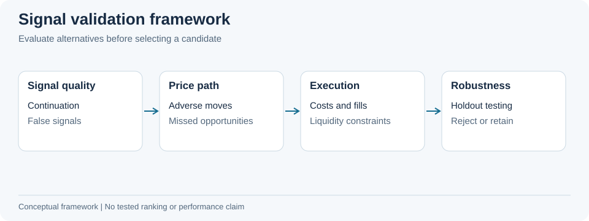

# Methodology overview
The study targets newly launched cryptocurrency tokens rather than every new exchange pair. Exchange notices and observed trading histories are used to establish eligibility. Premarket instruments and uncertain identities are tracked separately.

Price paths are evaluated using completed candles and information available at the decision time. Multi-timeframe comparisons consider both remaining downside and adverse rebounds, including delayed entries and missing signals. Historical observations are not assumed independent merely because they come from different markets or configurations.

Execution assumptions, costs, incomplete observation windows and out-of-sample validation are essential before drawing strategy conclusions. Detailed signal specifications and implementation are proprietary.

## Validation design

*Figure 1. Conceptual evaluation framework. No measured rankings are shown.*

Compare candidate approaches on common observation windows, account for censored paths and correlated observations, and assess delayed or missing entries. Reject unsupported candidates; retain negative findings. Exact thresholds, windows, risk rules and implementation are intentionally withheld.
