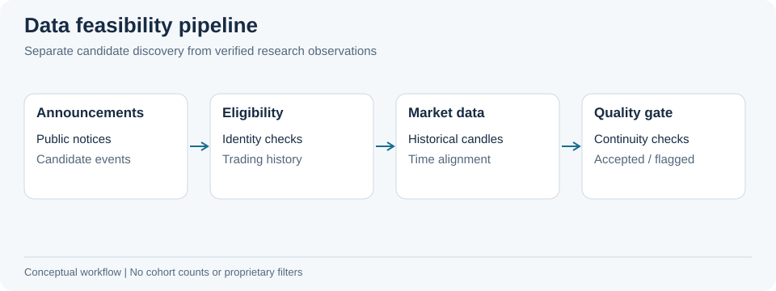
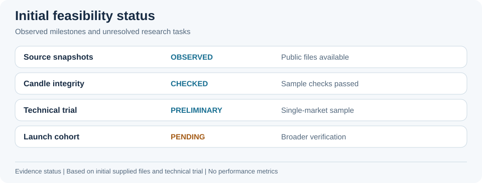

# Stage 01 — Initial data feasibility

**Research record | 25 November 2026 | Preliminary**

## Abstract
Initial announcement snapshots and historical futures candles were inspected to determine whether the planned empirical investigation is technically feasible. The evidence supports proceeding with broader data collection, not a claim of predictive or trading performance.

## Research question
Can public announcement sources identify candidate events and can historical market data support price-path analysis?

## Materials and methods
The initial evidence comprises public announcement snapshots from an exchange API and secondary discovery services, plus a historical futures candle archive. Source categories were inspected for unrelated events. The candle sample was checked for unique timestamps, minute continuity and basic OHLC consistency. A preliminary single-market technical trial evaluated multiple observation windows.

*Figure 1. Conceptual pipeline; the full eligibility stage is pending.*

## Observations
- Announcement records are accessible, but broad categories can include copy-trading updates and traditional-finance instruments.
- The supplied candle sample passed the stated structural checks.
- A technical price-path trial was conducted; launch timing and population-level conclusions remain unverified.

*Figure 2. Evidence status, not a performance chart.*

## Interpretation and limitations
An announcement is not proof of a new underlying token, nor of executable trading availability. The sample is not a validated launch cohort. A single market-day cannot establish statistical robustness. Candle observations do not resolve every intrabar ordering or actual execution price. Costs and independent validation remain pending.

## Conclusion and next stage
Initial technical feasibility is supported. The next stage is historical candidate collection, launch eligibility checks and expanded market-data coverage. No trading rule has been selected.

## Sources
See [source register](../docs/data_sources.md) and [limitations](../docs/limitations.md).
